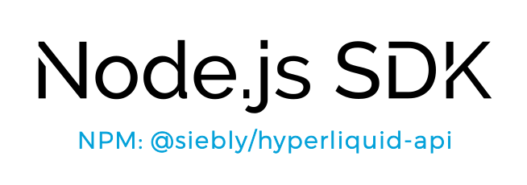

# Endpoint maps

  <a href="https://www.npmjs.com/package/@siebly/hyperliquid-api">
    <picture>
      <source media="(prefers-color-scheme: dark)" srcset="https://github.com/sieblyio/hyperliquid-api/blob/main/docs/images/logoDarkMode2.svg?raw=true#gh-dark-mode-only">
      
    </picture>
  </a>

Each REST client is a JavaScript class, which provides functions individually mapped to each endpoint available in the exchange's API offering. 

The following table shows all methods available in each REST client, whether the method requires authentication (automatically handled if a private key or signer is provided), as well as the exact endpoint each method is connected to.

Hyperliquid exposes two HTTP paths: `POST /info` and `POST /exchange`. The value in parentheses is the request `type` field from the official docs (for example `allMids`, `order`, `usdSend`). Search this table for that type name to find the SDK function.

This can be used to easily find which method to call, once you have [found which endpoint you're looking to use](https://github.com/sieblyio/awesome-crypto-examples/wiki/How-to-find-SDK-functions-that-match-API-docs-endpoint).

All REST clients are in the [src](/src) folder. For usage examples, make sure to check the [examples](/examples) folder.

List of clients:
- [RestClient](#restclientts)

If anything is missing or wrong, please open an issue or let us know in our [Node.js Traders](https://t.me/nodetraders) telegram group!

## How to use table

Table consists of 4 parts:

- Function name
- AUTH
- HTTP Method
- Endpoint

**Function name** is the name of the function that can be called through the SDK. Check examples folder in the repo for more help on how to use them!

**AUTH** is a boolean value that indicates if the function requires authentication - which means you need to pass your private key or a signer to the SDK. Public Info calls work with `new RestClient()`. Account Info, L1 actions, and user-signed actions need credentials.

**HTTP Method** shows HTTP method that the function uses to call the endpoint. Hyperliquid uses POST for both Info and Exchange.

**Endpoint** is the path plus Hyperliquid `type`. Best way to find exact function you need is to search for the official `type` (or `/info` / `/exchange`) in this table and find corresponding function name.

# RestClient.ts

This table includes all endpoints from the official Exchange API docs and corresponding SDK functions for each endpoint that are found in [RestClient.ts](/src/RestClient.ts). 

WebsocketAPIClient extends RestClient and exposes the same methods over Hyperliquid's WebSocket POST protocol (`info` / `action`).

| Function | AUTH | HTTP Method | Endpoint |
| -------- | :------: | :------: | -------- |
| [getAllMids()](https://github.com/sieblyio/hyperliquid-api/blob/main/src/RestClient.ts#L200) |  | POST | `/info (allMids)` |
| [getActiveAssetData()](https://github.com/sieblyio/hyperliquid-api/blob/main/src/RestClient.ts#L208) | :closed_lock_with_key:  | POST | `/info (activeAssetData)` |
| [getAllBorrowLendReserveStates()](https://github.com/sieblyio/hyperliquid-api/blob/main/src/RestClient.ts#L219) |  | POST | `/info (allBorrowLendReserveStates)` |
| [getAllPerpMetadata()](https://github.com/sieblyio/hyperliquid-api/blob/main/src/RestClient.ts#L229) |  | POST | `/info (allPerpMetas)` |
| [getApprovedBuilders()](https://github.com/sieblyio/hyperliquid-api/blob/main/src/RestClient.ts#L236) | :closed_lock_with_key:  | POST | `/info (approvedBuilders)` |
| [getBorrowLendReserveState()](https://github.com/sieblyio/hyperliquid-api/blob/main/src/RestClient.ts#L243) |  | POST | `/info (borrowLendReserveState)` |
| [getUserBorrowLendState()](https://github.com/sieblyio/hyperliquid-api/blob/main/src/RestClient.ts#L254) | :closed_lock_with_key:  | POST | `/info (borrowLendUserState)` |
| [getCandles()](https://github.com/sieblyio/hyperliquid-api/blob/main/src/RestClient.ts#L266) |  | POST | `/info (candleSnapshot)` |
| [getPerpAccountSummary()](https://github.com/sieblyio/hyperliquid-api/blob/main/src/RestClient.ts#L279) | :closed_lock_with_key:  | POST | `/info (clearinghouseState)` |
| [getStakingDelegations()](https://github.com/sieblyio/hyperliquid-api/blob/main/src/RestClient.ts#L288) | :closed_lock_with_key:  | POST | `/info (delegations)` |
| [getStakingHistory()](https://github.com/sieblyio/hyperliquid-api/blob/main/src/RestClient.ts#L299) | :closed_lock_with_key:  | POST | `/info (delegatorHistory)` |
| [getStakingRewards()](https://github.com/sieblyio/hyperliquid-api/blob/main/src/RestClient.ts#L310) | :closed_lock_with_key:  | POST | `/info (delegatorRewards)` |
| [getStakingSummary()](https://github.com/sieblyio/hyperliquid-api/blob/main/src/RestClient.ts#L317) | :closed_lock_with_key:  | POST | `/info (delegatorSummary)` |
| [getExchangeStatus()](https://github.com/sieblyio/hyperliquid-api/blob/main/src/RestClient.ts#L321) |  | POST | `/info (exchangeStatus)` |
| [getExtraAgents()](https://github.com/sieblyio/hyperliquid-api/blob/main/src/RestClient.ts#L325) | :closed_lock_with_key:  | POST | `/info (extraAgents)` |
| [getFrontendOpenOrders()](https://github.com/sieblyio/hyperliquid-api/blob/main/src/RestClient.ts#L334) | :closed_lock_with_key:  | POST | `/info (frontendOpenOrders)` |
| [getFundingHistory()](https://github.com/sieblyio/hyperliquid-api/blob/main/src/RestClient.ts#L343) |  | POST | `/info (fundingHistory)` |
| [getGossipPriorityAuctionStatus()](https://github.com/sieblyio/hyperliquid-api/blob/main/src/RestClient.ts#L352) |  | POST | `/info (gossipPriorityAuctionStatus)` |
| [getGossipRootIps()](https://github.com/sieblyio/hyperliquid-api/blob/main/src/RestClient.ts#L356) |  | POST | `/info (gossipRootIps)` |
| [getOrderHistory()](https://github.com/sieblyio/hyperliquid-api/blob/main/src/RestClient.ts#L365) | :closed_lock_with_key:  | POST | `/info (historicalOrders)` |
| [getVipStatus()](https://github.com/sieblyio/hyperliquid-api/blob/main/src/RestClient.ts#L369) | :closed_lock_with_key:  | POST | `/info (isVip)` |
| [getOrderBook()](https://github.com/sieblyio/hyperliquid-api/blob/main/src/RestClient.ts#L379) |  | POST | `/info (l2Book)` |
| [getLeadingVaults()](https://github.com/sieblyio/hyperliquid-api/blob/main/src/RestClient.ts#L388) | :closed_lock_with_key:  | POST | `/info (leadingVaults)` |
| [getLegalStatus()](https://github.com/sieblyio/hyperliquid-api/blob/main/src/RestClient.ts#L392) | :closed_lock_with_key:  | POST | `/info (legalCheck)` |
| [getLiquidatablePositions()](https://github.com/sieblyio/hyperliquid-api/blob/main/src/RestClient.ts#L396) |  | POST | `/info (liquidatable)` |
| [getMarginTable()](https://github.com/sieblyio/hyperliquid-api/blob/main/src/RestClient.ts#L400) |  | POST | `/info (marginTable)` |
| [getMaxBuilderFee()](https://github.com/sieblyio/hyperliquid-api/blob/main/src/RestClient.ts#L409) | :closed_lock_with_key:  | POST | `/info (maxBuilderFee)` |
| [getMaxMarketOrderNotionals()](https://github.com/sieblyio/hyperliquid-api/blob/main/src/RestClient.ts#L413) |  | POST | `/info (maxMarketOrderNtls)` |
| [getPerpMetadata()](https://github.com/sieblyio/hyperliquid-api/blob/main/src/RestClient.ts#L422) |  | POST | `/info (meta)` |
| [getPerpAssetContexts()](https://github.com/sieblyio/hyperliquid-api/blob/main/src/RestClient.ts#L433) |  | POST | `/info (metaAndAssetCtxs)` |
| [getOpenOrders()](https://github.com/sieblyio/hyperliquid-api/blob/main/src/RestClient.ts#L445) | :closed_lock_with_key:  | POST | `/info (openOrders)` |
| [getOrderStatus()](https://github.com/sieblyio/hyperliquid-api/blob/main/src/RestClient.ts#L455) | :closed_lock_with_key:  | POST | `/info (orderStatus)` |
| [getOutcomeMetadata()](https://github.com/sieblyio/hyperliquid-api/blob/main/src/RestClient.ts#L462) |  | POST | `/info (outcomeMeta)` |
| [getOutcomeDeployerLimits()](https://github.com/sieblyio/hyperliquid-api/blob/main/src/RestClient.ts#L471) |  | POST | `/info (outcomeDeployerLimits)` |
| [getPerpAnnotation()](https://github.com/sieblyio/hyperliquid-api/blob/main/src/RestClient.ts#L482) |  | POST | `/info (perpAnnotation)` |
| [getPerpCategories()](https://github.com/sieblyio/hyperliquid-api/blob/main/src/RestClient.ts#L491) |  | POST | `/info (perpCategories)` |
| [getConcisePerpAnnotations()](https://github.com/sieblyio/hyperliquid-api/blob/main/src/RestClient.ts#L500) |  | POST | `/info (perpConciseAnnotations)` |
| [getPerpDeployAuctionStatus()](https://github.com/sieblyio/hyperliquid-api/blob/main/src/RestClient.ts#L507) |  | POST | `/info (perpDeployAuctionStatus)` |
| [getPerpDexLimits()](https://github.com/sieblyio/hyperliquid-api/blob/main/src/RestClient.ts#L516) |  | POST | `/info (perpDexLimits)` |
| [getPerpDexStatus()](https://github.com/sieblyio/hyperliquid-api/blob/main/src/RestClient.ts#L525) |  | POST | `/info (perpDexStatus)` |
| [getPerpDexs()](https://github.com/sieblyio/hyperliquid-api/blob/main/src/RestClient.ts#L535) |  | POST | `/info (perpDexs)` |
| [getPerpsAtOpenInterestCap()](https://github.com/sieblyio/hyperliquid-api/blob/main/src/RestClient.ts#L544) |  | POST | `/info (perpsAtOpenInterestCap)` |
| [getPortfolio()](https://github.com/sieblyio/hyperliquid-api/blob/main/src/RestClient.ts#L554) | :closed_lock_with_key:  | POST | `/info (portfolio)` |
| [getPreTransferCheck()](https://github.com/sieblyio/hyperliquid-api/blob/main/src/RestClient.ts#L558) |  | POST | `/info (preTransferCheck)` |
| [getPredictedFundingRates()](https://github.com/sieblyio/hyperliquid-api/blob/main/src/RestClient.ts#L571) |  | POST | `/info (predictedFundings)` |
| [getRecentTrades()](https://github.com/sieblyio/hyperliquid-api/blob/main/src/RestClient.ts#L575) |  | POST | `/info (recentTrades)` |
| [getReferralInfo()](https://github.com/sieblyio/hyperliquid-api/blob/main/src/RestClient.ts#L586) | :closed_lock_with_key:  | POST | `/info (referral)` |
| [getSettledOutcome()](https://github.com/sieblyio/hyperliquid-api/blob/main/src/RestClient.ts#L595) |  | POST | `/info (settledOutcome)` |
| [getBalances()](https://github.com/sieblyio/hyperliquid-api/blob/main/src/RestClient.ts#L601) | :closed_lock_with_key:  | POST | `/info (clearinghouseState, spotClearinghouseState)` |
| [getSpotBalances()](https://github.com/sieblyio/hyperliquid-api/blob/main/src/RestClient.ts#L622) | :closed_lock_with_key:  | POST | `/info (spotClearinghouseState)` |
| [getSpotDeployAuctionStatus()](https://github.com/sieblyio/hyperliquid-api/blob/main/src/RestClient.ts#L629) | :closed_lock_with_key:  | POST | `/info (spotDeployState)` |
| [getSpotMetadata()](https://github.com/sieblyio/hyperliquid-api/blob/main/src/RestClient.ts#L638) |  | POST | `/info (spotMeta)` |
| [getSpotAssetContexts()](https://github.com/sieblyio/hyperliquid-api/blob/main/src/RestClient.ts#L648) |  | POST | `/info (spotMetaAndAssetCtxs)` |
| [getSpotPairDeployAuctionStatus()](https://github.com/sieblyio/hyperliquid-api/blob/main/src/RestClient.ts#L655) |  | POST | `/info (spotPairDeployAuctionStatus)` |
| [getSubAccounts()](https://github.com/sieblyio/hyperliquid-api/blob/main/src/RestClient.ts#L664) | :closed_lock_with_key:  | POST | `/info (subAccounts)` |
| [getSubAccountsWithAllDexStates()](https://github.com/sieblyio/hyperliquid-api/blob/main/src/RestClient.ts#L668) | :closed_lock_with_key:  | POST | `/info (subAccounts2)` |
| [getTokenDetails()](https://github.com/sieblyio/hyperliquid-api/blob/main/src/RestClient.ts#L680) |  | POST | `/info (tokenDetails)` |
| [getTwapHistory()](https://github.com/sieblyio/hyperliquid-api/blob/main/src/RestClient.ts#L684) | :closed_lock_with_key:  | POST | `/info (twapHistory)` |
| [getUserAbstraction()](https://github.com/sieblyio/hyperliquid-api/blob/main/src/RestClient.ts#L691) | :closed_lock_with_key:  | POST | `/info (userAbstraction)` |
| [getUserBorrowLendInterest()](https://github.com/sieblyio/hyperliquid-api/blob/main/src/RestClient.ts#L695) | :closed_lock_with_key:  | POST | `/info (userBorrowLendInterest)` |
| [getUserDexAbstraction()](https://github.com/sieblyio/hyperliquid-api/blob/main/src/RestClient.ts#L704) | :closed_lock_with_key:  | POST | `/info (userDexAbstraction)` |
| [getUserFees()](https://github.com/sieblyio/hyperliquid-api/blob/main/src/RestClient.ts#L711) | :closed_lock_with_key:  | POST | `/info (userFees)` |
| [getUserFills()](https://github.com/sieblyio/hyperliquid-api/blob/main/src/RestClient.ts#L721) | :closed_lock_with_key:  | POST | `/info (userFills)` |
| [getUserFillsByTime()](https://github.com/sieblyio/hyperliquid-api/blob/main/src/RestClient.ts#L731) | :closed_lock_with_key:  | POST | `/info (userFillsByTime)` |
| [getUserFundingHistory()](https://github.com/sieblyio/hyperliquid-api/blob/main/src/RestClient.ts#L740) | :closed_lock_with_key:  | POST | `/info (userFunding)` |
| [getUserNonFundingLedgerUpdates()](https://github.com/sieblyio/hyperliquid-api/blob/main/src/RestClient.ts#L753) | :closed_lock_with_key:  | POST | `/info (userNonFundingLedgerUpdates)` |
| [getUserRateLimit()](https://github.com/sieblyio/hyperliquid-api/blob/main/src/RestClient.ts#L765) | :closed_lock_with_key:  | POST | `/info (userRateLimit)` |
| [getUserRole()](https://github.com/sieblyio/hyperliquid-api/blob/main/src/RestClient.ts#L775) |  | POST | `/info (userRole)` |
| [getMultiSigSigners()](https://github.com/sieblyio/hyperliquid-api/blob/main/src/RestClient.ts#L779) | :closed_lock_with_key:  | POST | `/info (userToMultiSigSigners)` |
| [getUserTwapSliceFills()](https://github.com/sieblyio/hyperliquid-api/blob/main/src/RestClient.ts#L790) | :closed_lock_with_key:  | POST | `/info (userTwapSliceFills)` |
| [getUserTwapSliceFillsByTime()](https://github.com/sieblyio/hyperliquid-api/blob/main/src/RestClient.ts#L794) | :closed_lock_with_key:  | POST | `/info (userTwapSliceFillsByTime)` |
| [getUserVaultDeposits()](https://github.com/sieblyio/hyperliquid-api/blob/main/src/RestClient.ts#L803) | :closed_lock_with_key:  | POST | `/info (userVaultEquities)` |
| [getValidatorL1Votes()](https://github.com/sieblyio/hyperliquid-api/blob/main/src/RestClient.ts#L809) |  | POST | `/info (validatorL1Votes)` |
| [getValidatorSummaries()](https://github.com/sieblyio/hyperliquid-api/blob/main/src/RestClient.ts#L813) |  | POST | `/info (validatorSummaries)` |
| [getVaultDetails()](https://github.com/sieblyio/hyperliquid-api/blob/main/src/RestClient.ts#L823) |  | POST | `/info (vaultDetails)` |
| [getVaultSummaries()](https://github.com/sieblyio/hyperliquid-api/blob/main/src/RestClient.ts#L829) |  | POST | `/info (vaultSummaries)` |
| [getWebData2()](https://github.com/sieblyio/hyperliquid-api/blob/main/src/RestClient.ts#L833) | :closed_lock_with_key:  | POST | `/info (webData2)` |
| [getAlignedQuoteTokenStatus()](https://github.com/sieblyio/hyperliquid-api/blob/main/src/RestClient.ts#L838) |  | POST | `/info (alignedQuoteTokenInfo)` |
| [submitOrder()](https://github.com/sieblyio/hyperliquid-api/blob/main/src/RestClient.ts#L850) | :closed_lock_with_key:  | POST | `/exchange (order)` |
| [submitMarketOrder()](https://github.com/sieblyio/hyperliquid-api/blob/main/src/RestClient.ts#L866) | :closed_lock_with_key:  | POST | `/exchange (order)` |
| [submitMarketClose()](https://github.com/sieblyio/hyperliquid-api/blob/main/src/RestClient.ts#L921) | :closed_lock_with_key:  | POST | `/exchange (order)` |
| [submitLimitOrder()](https://github.com/sieblyio/hyperliquid-api/blob/main/src/RestClient.ts#L965) | :closed_lock_with_key:  | POST | `/exchange (order)` |
| [modifyOrder()](https://github.com/sieblyio/hyperliquid-api/blob/main/src/RestClient.ts#L1007) | :closed_lock_with_key:  | POST | `/exchange (modify)` |
| [modifyOrders()](https://github.com/sieblyio/hyperliquid-api/blob/main/src/RestClient.ts#L1023) | :closed_lock_with_key:  | POST | `/exchange (batchModify)` |
| [cancelOrders()](https://github.com/sieblyio/hyperliquid-api/blob/main/src/RestClient.ts#L1042) | :closed_lock_with_key:  | POST | `/exchange (cancel)` |
| [cancelOrdersByClientOrderId()](https://github.com/sieblyio/hyperliquid-api/blob/main/src/RestClient.ts#L1060) | :closed_lock_with_key:  | POST | `/exchange (cancelByCloid)` |
| [updateLeverage()](https://github.com/sieblyio/hyperliquid-api/blob/main/src/RestClient.ts#L1076) | :closed_lock_with_key:  | POST | `/exchange (updateLeverage)` |
| [updateIsolatedMargin()](https://github.com/sieblyio/hyperliquid-api/blob/main/src/RestClient.ts#L1096) | :closed_lock_with_key:  | POST | `/exchange (updateIsolatedMargin)` |
| [setIsolatedMarginLeverage()](https://github.com/sieblyio/hyperliquid-api/blob/main/src/RestClient.ts#L1108) | :closed_lock_with_key:  | POST | `/exchange (topUpIsolatedOnlyMargin)` |
| [submitTwapOrder()](https://github.com/sieblyio/hyperliquid-api/blob/main/src/RestClient.ts#L1124) | :closed_lock_with_key:  | POST | `/exchange (twapOrder)` |
| [cancelTwapOrder()](https://github.com/sieblyio/hyperliquid-api/blob/main/src/RestClient.ts#L1136) | :closed_lock_with_key:  | POST | `/exchange (twapCancel)` |
| [submitTrailingStop()](https://github.com/sieblyio/hyperliquid-api/blob/main/src/RestClient.ts#L1150) | :closed_lock_with_key:  | POST | `/exchange (trailingStop)` |
| [setCancelAllAfter()](https://github.com/sieblyio/hyperliquid-api/blob/main/src/RestClient.ts#L1163) | :closed_lock_with_key:  | POST | `/exchange (scheduleCancel)` |
| [setReferrer()](https://github.com/sieblyio/hyperliquid-api/blob/main/src/RestClient.ts#L1170) | :closed_lock_with_key:  | POST | `/exchange (setReferrer)` |
| [registerReferrer()](https://github.com/sieblyio/hyperliquid-api/blob/main/src/RestClient.ts#L1176) | :closed_lock_with_key:  | POST | `/exchange (registerReferrer)` |
| [approveApiWallet()](https://github.com/sieblyio/hyperliquid-api/blob/main/src/RestClient.ts#L1214) | :closed_lock_with_key:  | POST | `/exchange (approveAgent)` |
| [sendUsd()](https://github.com/sieblyio/hyperliquid-api/blob/main/src/RestClient.ts#L1234) | :closed_lock_with_key:  | POST | `/exchange (usdSend)` |
| [sendSpotAsset()](https://github.com/sieblyio/hyperliquid-api/blob/main/src/RestClient.ts#L1251) | :closed_lock_with_key:  | POST | `/exchange (spotSend)` |
| [withdrawUsd()](https://github.com/sieblyio/hyperliquid-api/blob/main/src/RestClient.ts#L1266) | :closed_lock_with_key:  | POST | `/exchange (withdraw3)` |
| [transferUsdBetweenSpotAndPerp()](https://github.com/sieblyio/hyperliquid-api/blob/main/src/RestClient.ts#L1283) | :closed_lock_with_key:  | POST | `/exchange (usdClassTransfer)` |
| [sendAsset()](https://github.com/sieblyio/hyperliquid-api/blob/main/src/RestClient.ts#L1301) | :closed_lock_with_key:  | POST | `/exchange (sendAsset)` |
| [sendToEvmWithData()](https://github.com/sieblyio/hyperliquid-api/blob/main/src/RestClient.ts#L1322) | :closed_lock_with_key:  | POST | `/exchange (sendToEvmWithData)` |
| [sendAssetFromApiWallet()](https://github.com/sieblyio/hyperliquid-api/blob/main/src/RestClient.ts#L1339) | :closed_lock_with_key:  | POST | `/exchange (agentSendAsset)` |
| [depositIntoStaking()](https://github.com/sieblyio/hyperliquid-api/blob/main/src/RestClient.ts#L1360) | :closed_lock_with_key:  | POST | `/exchange (cDeposit)` |
| [withdrawFromStaking()](https://github.com/sieblyio/hyperliquid-api/blob/main/src/RestClient.ts#L1377) | :closed_lock_with_key:  | POST | `/exchange (cWithdraw)` |
| [delegateOrUndelegateStake()](https://github.com/sieblyio/hyperliquid-api/blob/main/src/RestClient.ts#L1394) | :closed_lock_with_key:  | POST | `/exchange (tokenDelegate)` |
| [convertToMultiSigUser()](https://github.com/sieblyio/hyperliquid-api/blob/main/src/RestClient.ts#L1406) | :closed_lock_with_key:  | POST | `/exchange (convertToMultiSigUser)` |
| [linkStakingAccount()](https://github.com/sieblyio/hyperliquid-api/blob/main/src/RestClient.ts#L1429) | :closed_lock_with_key:  | POST | `/exchange (linkStakingUser)` |
| [disableStakingTradingLink()](https://github.com/sieblyio/hyperliquid-api/blob/main/src/RestClient.ts#L1441) | :closed_lock_with_key:  | POST | `/exchange (stakingLinkDisableTradingUser)` |
| [setUserPortfolioMargin()](https://github.com/sieblyio/hyperliquid-api/blob/main/src/RestClient.ts#L1453) | :closed_lock_with_key:  | POST | `/exchange (userPortfolioMargin)` |
| [setUserAbstraction()](https://github.com/sieblyio/hyperliquid-api/blob/main/src/RestClient.ts#L1470) | :closed_lock_with_key:  | POST | `/exchange (userSetAbstraction)` |
| [setUserDexAbstraction()](https://github.com/sieblyio/hyperliquid-api/blob/main/src/RestClient.ts#L1487) | :closed_lock_with_key:  | POST | `/exchange (userDexAbstraction)` |
| [enableApiWalletDexAbstraction()](https://github.com/sieblyio/hyperliquid-api/blob/main/src/RestClient.ts#L1504) | :closed_lock_with_key:  | POST | `/exchange (agentEnableDexAbstraction)` |
| [setApiWalletAbstraction()](https://github.com/sieblyio/hyperliquid-api/blob/main/src/RestClient.ts#L1515) | :closed_lock_with_key:  | POST | `/exchange (agentSetAbstraction)` |
| [executeBorrowLendOperation()](https://github.com/sieblyio/hyperliquid-api/blob/main/src/RestClient.ts#L1522) | :closed_lock_with_key:  | POST | `/exchange (borrowLend)` |
| [claimRewards()](https://github.com/sieblyio/hyperliquid-api/blob/main/src/RestClient.ts#L1543) | :closed_lock_with_key:  | POST | `/exchange (claimRewards)` |
| [createSubAccount()](https://github.com/sieblyio/hyperliquid-api/blob/main/src/RestClient.ts#L1547) | :closed_lock_with_key:  | POST | `/exchange (createSubAccount)` |
| [createVault()](https://github.com/sieblyio/hyperliquid-api/blob/main/src/RestClient.ts#L1554) | :closed_lock_with_key:  | POST | `/exchange (createVault)` |
| [setEvmBigBlocks()](https://github.com/sieblyio/hyperliquid-api/blob/main/src/RestClient.ts#L1561) | :closed_lock_with_key:  | POST | `/exchange (evmUserModify)` |
| [finalizeEvmContract()](https://github.com/sieblyio/hyperliquid-api/blob/main/src/RestClient.ts#L1568) | :closed_lock_with_key:  | POST | `/exchange (finalizeEvmContract)` |
| [submitGossipPriorityBid()](https://github.com/sieblyio/hyperliquid-api/blob/main/src/RestClient.ts#L1581) | :closed_lock_with_key:  | POST | `/exchange (gossipPriorityBid)` |
| [transferHip3LiquidatorFunds()](https://github.com/sieblyio/hyperliquid-api/blob/main/src/RestClient.ts#L1594) | :closed_lock_with_key:  | POST | `/exchange (hip3LiquidatorTransfer)` |
| [invalidateNonce()](https://github.com/sieblyio/hyperliquid-api/blob/main/src/RestClient.ts#L1604) | :closed_lock_with_key:  | POST | `/exchange (noop)` |
| [deployPerp()](https://github.com/sieblyio/hyperliquid-api/blob/main/src/RestClient.ts#L1608) | :closed_lock_with_key:  | POST | `/exchange (perpDeploy)` |
| [deploySpot()](https://github.com/sieblyio/hyperliquid-api/blob/main/src/RestClient.ts#L1615) | :closed_lock_with_key:  | POST | `/exchange (spotDeploy)` |
| [reserveAdditionalActions()](https://github.com/sieblyio/hyperliquid-api/blob/main/src/RestClient.ts#L1627) | :closed_lock_with_key:  | POST | `/exchange (reserveRequestWeight)` |
| [setDisplayName()](https://github.com/sieblyio/hyperliquid-api/blob/main/src/RestClient.ts#L1634) | :closed_lock_with_key:  | POST | `/exchange (setDisplayName)` |
| [setSpotDusting()](https://github.com/sieblyio/hyperliquid-api/blob/main/src/RestClient.ts#L1641) | :closed_lock_with_key:  | POST | `/exchange (spotUser)` |
| [renameSubAccount()](https://github.com/sieblyio/hyperliquid-api/blob/main/src/RestClient.ts#L1648) | :closed_lock_with_key:  | POST | `/exchange (subAccountModify)` |
| [transferSpotToOrFromSubAccount()](https://github.com/sieblyio/hyperliquid-api/blob/main/src/RestClient.ts#L1655) | :closed_lock_with_key:  | POST | `/exchange (subAccountSpotTransfer)` |
| [transferUsdToOrFromSubAccount()](https://github.com/sieblyio/hyperliquid-api/blob/main/src/RestClient.ts#L1666) | :closed_lock_with_key:  | POST | `/exchange (subAccountTransfer)` |
| [transferVaultFunds()](https://github.com/sieblyio/hyperliquid-api/blob/main/src/RestClient.ts#L1676) | :closed_lock_with_key:  | POST | `/exchange (vaultTransfer)` |
| [distributeVaultFunds()](https://github.com/sieblyio/hyperliquid-api/blob/main/src/RestClient.ts#L1683) | :closed_lock_with_key:  | POST | `/exchange (vaultDistribute)` |
| [modifyVault()](https://github.com/sieblyio/hyperliquid-api/blob/main/src/RestClient.ts#L1690) | :closed_lock_with_key:  | POST | `/exchange (vaultModify)` |
| [updateValidatorL1Stream()](https://github.com/sieblyio/hyperliquid-api/blob/main/src/RestClient.ts#L1714) | :closed_lock_with_key:  | POST | `/exchange (validatorL1Stream)` |
| [submitSignerAction()](https://github.com/sieblyio/hyperliquid-api/blob/main/src/RestClient.ts#L1725) | :closed_lock_with_key:  | POST | `/exchange (CSignerAction)` |
| [submitValidatorAction()](https://github.com/sieblyio/hyperliquid-api/blob/main/src/RestClient.ts#L1732) | :closed_lock_with_key:  | POST | `/exchange (CValidatorAction)` |
| [authorizeAqav2Role()](https://github.com/sieblyio/hyperliquid-api/blob/main/src/RestClient.ts#L1745) | :closed_lock_with_key:  | POST | `/exchange (authorizeAqav2Role)` |
| [submitUserOutcome()](https://github.com/sieblyio/hyperliquid-api/blob/main/src/RestClient.ts#L1760) | :closed_lock_with_key:  | POST | `/exchange (userOutcome)` |